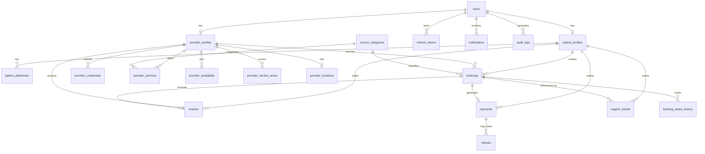
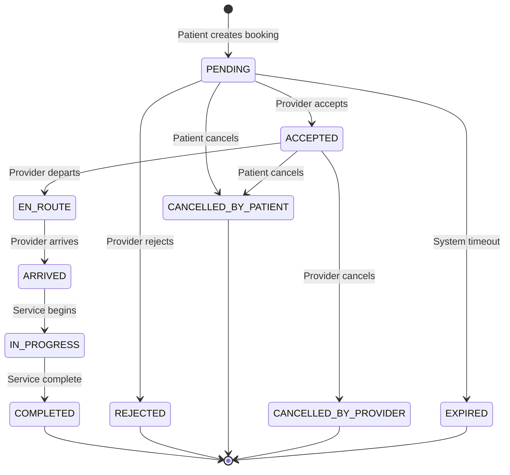
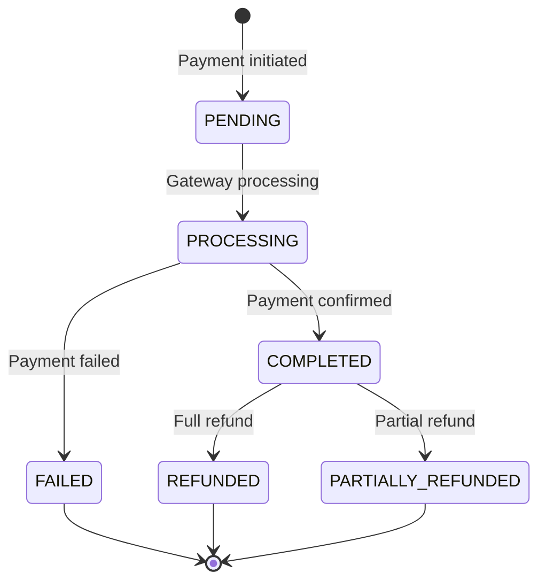

# MEDICONNECT — Entity Relationship Diagram

## Database Architecture

The MEDICONNECT platform uses a normalized MySQL 8 schema with 20 tables. All tables use `CHAR(36)` UUID primary keys, `UTF8MB4` character set, and UTC timestamps.

---

## ER Diagram

---

## Table Details

### 1. `users`
The central authentication table for all platform users.

| Column | Type | Constraints |
|--------|------|-------------|
| id | CHAR(36) | PK, UUID |
| email | VARCHAR(255) | UNIQUE, NOT NULL |
| phone | VARCHAR(20) | UNIQUE, nullable |
| password_hash | VARCHAR(255) | NOT NULL |
| role | ENUM('PATIENT','PROVIDER','ADMIN','SUPPORT') | NOT NULL |
| is_active | BOOLEAN | DEFAULT TRUE |
| email_verified_at | DATETIME | nullable |
| last_login_at | DATETIME | nullable |
| created_at | DATETIME | NOT NULL, DEFAULT UTC |
| updated_at | DATETIME | NOT NULL, DEFAULT UTC |

### 2. `refresh_tokens`
Stores JWT refresh tokens for session management.

| Column | Type | Constraints |
|--------|------|-------------|
| id | CHAR(36) | PK |
| user_id | CHAR(36) | FK → users.id |
| token_hash | VARCHAR(500) | NOT NULL |
| expires_at | DATETIME | NOT NULL |
| revoked_at | DATETIME | nullable |
| created_at | DATETIME | NOT NULL |

### 3. `patient_profiles`
Extended profile information for patients.

| Column | Type | Constraints |
|--------|------|-------------|
| id | CHAR(36) | PK |
| user_id | CHAR(36) | FK → users.id, UNIQUE |
| first_name | VARCHAR(100) | NOT NULL |
| last_name | VARCHAR(100) | NOT NULL |
| date_of_birth | DATE | nullable |
| gender | ENUM('MALE','FEMALE','OTHER','PREFER_NOT_TO_SAY') | nullable |
| profile_photo_url | VARCHAR(500) | nullable |
| emergency_contact_name | VARCHAR(200) | nullable |
| emergency_contact_phone | VARCHAR(20) | nullable |
| created_at / updated_at | DATETIME | NOT NULL |

### 4. `provider_profiles`
Extended profile for medical service providers.

| Column | Type | Constraints |
|--------|------|-------------|
| id | CHAR(36) | PK |
| user_id | CHAR(36) | FK → users.id, UNIQUE |
| provider_type | ENUM('DOCTOR','NURSE','LABORATORY','PHARMACY','AMBULANCE','PHYSIOTHERAPIST','HOME_CARE','OTHER') | NOT NULL |
| first_name | VARCHAR(100) | NOT NULL |
| last_name | VARCHAR(100) | NOT NULL |
| business_name | VARCHAR(200) | nullable |
| profile_photo_url | VARCHAR(500) | nullable |
| bio | TEXT | nullable |
| verification_status | ENUM('PENDING','UNDER_REVIEW','VERIFIED','REJECTED','SUSPENDED') | DEFAULT 'PENDING' |
| verification_notes | TEXT | nullable |
| average_rating | DECIMAL(3,2) | DEFAULT 0.00 |
| total_reviews | INT | DEFAULT 0 |
| is_available | BOOLEAN | DEFAULT FALSE |
| current_latitude | DECIMAL(10,8) | nullable |
| current_longitude | DECIMAL(11,8) | nullable |
| created_at / updated_at | DATETIME | NOT NULL |

### 5. `provider_credentials`
Professional license and certification documents.

| Column | Type | Constraints |
|--------|------|-------------|
| id | CHAR(36) | PK |
| provider_id | CHAR(36) | FK → provider_profiles.id |
| credential_type | VARCHAR(100) | NOT NULL |
| credential_number | VARCHAR(200) | NOT NULL |
| issuing_authority | VARCHAR(300) | NOT NULL |
| issue_date | DATE | NOT NULL |
| expiry_date | DATE | nullable |
| document_url | VARCHAR(500) | NOT NULL |
| verified_at | DATETIME | nullable |
| verified_by_user_id | CHAR(36) | FK → users.id, nullable |
| created_at / updated_at | DATETIME | NOT NULL |

### 6. `service_categories`
Platform-wide service type definitions.

| Column | Type | Constraints |
|--------|------|-------------|
| id | CHAR(36) | PK |
| slug | VARCHAR(100) | UNIQUE |
| name | VARCHAR(200) | NOT NULL |
| description | TEXT | nullable |
| icon_name | VARCHAR(100) | nullable |
| is_active | BOOLEAN | DEFAULT TRUE |
| display_order | INT | DEFAULT 0 |
| created_at / updated_at | DATETIME | NOT NULL |

### 7. `provider_services`
Links providers to service categories with pricing.

| Column | Type | Constraints |
|--------|------|-------------|
| id | CHAR(36) | PK |
| provider_id | CHAR(36) | FK → provider_profiles.id |
| category_id | CHAR(36) | FK → service_categories.id |
| description | TEXT | nullable |
| base_price | DECIMAL(10,2) | NOT NULL |
| price_unit | ENUM('PER_VISIT','PER_HOUR','FIXED') | NOT NULL |
| is_active | BOOLEAN | DEFAULT TRUE |
| created_at / updated_at | DATETIME | NOT NULL |
| | | UNIQUE(provider_id, category_id) |

### 8. `provider_availability`
Weekly working hours schedule.

| Column | Type | Constraints |
|--------|------|-------------|
| id | CHAR(36) | PK |
| provider_id | CHAR(36) | FK → provider_profiles.id |
| day_of_week | TINYINT | 0=Sun .. 6=Sat |
| start_time | TIME | NOT NULL |
| end_time | TIME | NOT NULL |
| is_active | BOOLEAN | DEFAULT TRUE |
| created_at / updated_at | DATETIME | NOT NULL |

### 9. `provider_service_areas`
Geographic coverage zones.

| Column | Type | Constraints |
|--------|------|-------------|
| id | CHAR(36) | PK |
| provider_id | CHAR(36) | FK → provider_profiles.id |
| area_name | VARCHAR(200) | NOT NULL |
| center_latitude | DECIMAL(10,8) | NOT NULL |
| center_longitude | DECIMAL(11,8) | NOT NULL |
| radius_km | DECIMAL(6,2) | DEFAULT 20.00 |
| is_active | BOOLEAN | DEFAULT TRUE |
| created_at / updated_at | DATETIME | NOT NULL |

### 10. `patient_addresses`
Saved patient addresses for service delivery.

| Column | Type | Constraints |
|--------|------|-------------|
| id | CHAR(36) | PK |
| patient_user_id | CHAR(36) | FK → users.id |
| label | VARCHAR(100) | NOT NULL |
| address_line | TEXT | NOT NULL |
| latitude | DECIMAL(10,8) | NOT NULL |
| longitude | DECIMAL(11,8) | NOT NULL |
| is_default | BOOLEAN | DEFAULT FALSE |
| created_at / updated_at | DATETIME | NOT NULL |

### 11. `bookings`
Core booking table — the heart of the Uber-like workflow.

| Column | Type | Constraints |
|--------|------|-------------|
| id | CHAR(36) | PK |
| patient_user_id | CHAR(36) | FK → users.id |
| provider_id | CHAR(36) | FK → provider_profiles.id, nullable |
| category_id | CHAR(36) | FK → service_categories.id |
| booking_type | ENUM('IMMEDIATE','SCHEDULED') | NOT NULL |
| status | ENUM('PENDING','ACCEPTED','EN_ROUTE','ARRIVED','IN_PROGRESS','COMPLETED','CANCELLED_BY_PATIENT','CANCELLED_BY_PROVIDER','REJECTED','EXPIRED') | NOT NULL |
| patient_address_id | CHAR(36) | FK → patient_addresses.id, nullable |
| patient_latitude | DECIMAL(10,8) | NOT NULL |
| patient_longitude | DECIMAL(11,8) | NOT NULL |
| patient_address_text | TEXT | nullable |
| scheduled_at | DATETIME | nullable |
| notes | TEXT | nullable |
| quoted_price | DECIMAL(10,2) | nullable |
| final_price | DECIMAL(10,2) | nullable |
| platform_commission | DECIMAL(10,2) | nullable |
| provider_payout | DECIMAL(10,2) | nullable |
| accepted_at | DATETIME | nullable |
| completed_at | DATETIME | nullable |
| cancelled_at | DATETIME | nullable |
| cancellation_reason | TEXT | nullable |
| created_at / updated_at | DATETIME | NOT NULL |

**Indexes:** status, patient_user_id, provider_id, category_id, booking_type, scheduled_at

### 12. `booking_status_history`
Audit trail of every booking status change.

| Column | Type | Constraints |
|--------|------|-------------|
| id | CHAR(36) | PK |
| booking_id | CHAR(36) | FK → bookings.id |
| from_status | VARCHAR(50) | NOT NULL |
| to_status | VARCHAR(50) | NOT NULL |
| changed_by_user_id | CHAR(36) | FK → users.id |
| notes | TEXT | nullable |
| created_at | DATETIME | NOT NULL |

### 13. `provider_locations`
Real-time provider location tracking.

| Column | Type | Constraints |
|--------|------|-------------|
| id | CHAR(36) | PK |
| provider_id | CHAR(36) | FK → provider_profiles.id, UNIQUE |
| latitude | DECIMAL(10,8) | NOT NULL |
| longitude | DECIMAL(11,8) | NOT NULL |
| updated_at | DATETIME | NOT NULL |

### 14. `payments`
Payment records linked to bookings.

| Column | Type | Constraints |
|--------|------|-------------|
| id | CHAR(36) | PK |
| booking_id | CHAR(36) | FK → bookings.id, UNIQUE |
| patient_user_id | CHAR(36) | FK → users.id |
| amount | DECIMAL(10,2) | NOT NULL |
| currency | CHAR(3) | DEFAULT 'KES' |
| payment_method | ENUM('MPESA','CARD','CASH','MOCK') | NOT NULL |
| status | ENUM('PENDING','PROCESSING','COMPLETED','FAILED','REFUNDED','PARTIALLY_REFUNDED') | NOT NULL |
| gateway_reference | VARCHAR(300) | nullable |
| gateway_response | JSON | nullable |
| idempotency_key | CHAR(36) | UNIQUE |
| paid_at | DATETIME | nullable |
| created_at / updated_at | DATETIME | NOT NULL |

### 15. `refunds`
Refund records linked to payments.

| Column | Type | Constraints |
|--------|------|-------------|
| id | CHAR(36) | PK |
| payment_id | CHAR(36) | FK → payments.id |
| requested_by_user_id | CHAR(36) | FK → users.id |
| amount | DECIMAL(10,2) | NOT NULL |
| reason | TEXT | NOT NULL |
| status | ENUM('PENDING','APPROVED','PROCESSED','REJECTED') | NOT NULL |
| processed_by_user_id | CHAR(36) | FK → users.id, nullable |
| gateway_reference | VARCHAR(300) | nullable |
| processed_at | DATETIME | nullable |
| created_at / updated_at | DATETIME | NOT NULL |

### 16. `reviews`
Patient reviews and ratings for providers.

| Column | Type | Constraints |
|--------|------|-------------|
| id | CHAR(36) | PK |
| booking_id | CHAR(36) | FK → bookings.id, UNIQUE |
| patient_user_id | CHAR(36) | FK → users.id |
| provider_id | CHAR(36) | FK → provider_profiles.id |
| rating | TINYINT | NOT NULL, CHECK 1–5 |
| comment | TEXT | nullable |
| is_visible | BOOLEAN | DEFAULT TRUE |
| created_at / updated_at | DATETIME | NOT NULL |

### 17. `notifications`
User notifications (in-app, email, SMS).

| Column | Type | Constraints |
|--------|------|-------------|
| id | CHAR(36) | PK |
| user_id | CHAR(36) | FK → users.id |
| type | VARCHAR(100) | NOT NULL |
| title | VARCHAR(500) | NOT NULL |
| body | TEXT | nullable |
| data | JSON | nullable |
| is_read | BOOLEAN | DEFAULT FALSE |
| read_at | DATETIME | nullable |
| created_at | DATETIME | NOT NULL |

### 18. `support_tickets`
Customer support case management.

| Column | Type | Constraints |
|--------|------|-------------|
| id | CHAR(36) | PK |
| patient_user_id | CHAR(36) | FK → users.id, nullable |
| provider_user_id | CHAR(36) | FK → users.id, nullable |
| booking_id | CHAR(36) | FK → bookings.id, nullable |
| subject | VARCHAR(500) | NOT NULL |
| description | TEXT | NOT NULL |
| status | ENUM('OPEN','IN_PROGRESS','RESOLVED','CLOSED') | NOT NULL |
| priority | ENUM('LOW','MEDIUM','HIGH','URGENT') | DEFAULT 'MEDIUM' |
| assigned_to_user_id | CHAR(36) | FK → users.id, nullable |
| resolved_at | DATETIME | nullable |
| created_at / updated_at | DATETIME | NOT NULL |

### 19. `audit_logs`
Immutable audit trail of all admin/system actions.

| Column | Type | Constraints |
|--------|------|-------------|
| id | CHAR(36) | PK |
| user_id | CHAR(36) | FK → users.id, nullable |
| action | VARCHAR(200) | NOT NULL |
| entity_type | VARCHAR(100) | nullable |
| entity_id | CHAR(36) | nullable |
| old_value | JSON | nullable |
| new_value | JSON | nullable |
| ip_address | VARCHAR(45) | nullable |
| user_agent | TEXT | nullable |
| created_at | DATETIME | NOT NULL |

### 20. `platform_settings`
Key-value configuration store for platform-wide settings.

| Column | Type | Constraints |
|--------|------|-------------|
| id | CHAR(36) | PK |
| key | VARCHAR(200) | UNIQUE |
| value | TEXT | NOT NULL |
| description | TEXT | nullable |
| updated_by_user_id | CHAR(36) | FK → users.id, nullable |
| updated_at | DATETIME | NOT NULL |

---

## Key Relationships Summary

| Parent | Child | FK Column | Relationship |
|--------|-------|-----------|-------------|
| users | patient_profiles | user_id | 1:1 |
| users | provider_profiles | user_id | 1:1 |
| users | refresh_tokens | user_id | 1:N |
| users | bookings | patient_user_id | 1:N |
| users | payments | patient_user_id | 1:N |
| users | notifications | user_id | 1:N |
| users | audit_logs | user_id | 1:N |
| provider_profiles | provider_credentials | provider_id | 1:N |
| provider_profiles | provider_services | provider_id | 1:N |
| provider_profiles | provider_availability | provider_id | 1:N |
| provider_profiles | provider_service_areas | provider_id | 1:N |
| provider_profiles | provider_locations | provider_id | 1:1 |
| provider_profiles | bookings | provider_id | 1:N |
| provider_profiles | reviews | provider_id | 1:N |
| service_categories | provider_services | category_id | 1:N |
| service_categories | bookings | category_id | 1:N |
| bookings | booking_status_history | booking_id | 1:N |
| bookings | payments | booking_id | 1:1 |
| bookings | reviews | booking_id | 1:1 |
| payments | refunds | payment_id | 1:N |

---

## Booking State Machine

---

## Payment Flow

